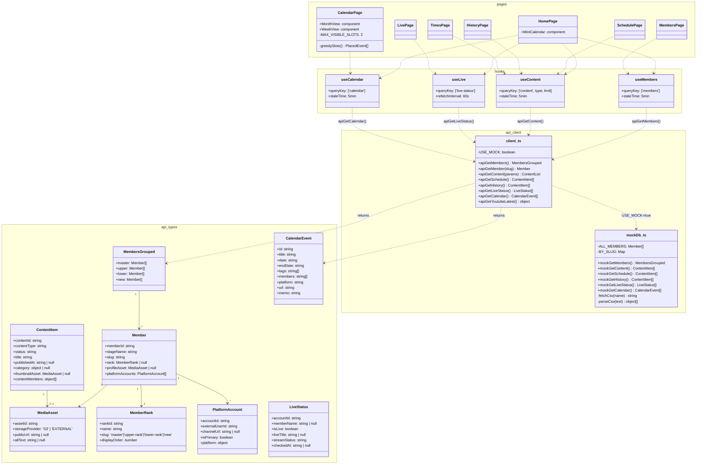

# GGU-CASTLE Frontend — `grx/`

꾸한성(GGU-CASTLE) 공식 팬사이트 프론트엔드. React 18 + Vite 5 + TypeScript SPA.

---

## 폴더 구성

```
grx/
├── index.html                  # Vite 진입점 (div#root)
├── vite.config.ts              # 빌드 설정 + dev proxy (/api → :3000)
├── package.json
│
├── public/                     # 정적 에셋 (빌드 시 그대로 복사)
│   ├── img/                    # 멤버 프로필 이미지
│   ├── img2/                   # 멤버 보조 이미지
│   ├── rika/                   # 리카 팬페이지 전용 이미지·오디오
│   └── mock/                   # Mock DB용 CSV 파일 5종
│       ├── grx - Times.csv     # 꾸창뉴스 기사 (NEWS)
│       ├── grx - Schedule.csv  # SOOP 방송공지 (SCHEDULE)
│       ├── grx - History.csv   # 게임 수상 내역 (GAME_EVENT)
│       ├── grx - Live.csv      # 라이브 상태 스냅샷
│       └── grx - Gallery.csv   # 갤러리 URL 목록
│
├── src/
│   ├── main.tsx                # ReactDOM.createRoot → App
│   ├── App.tsx                 # RouterProvider 마운트
│   ├── router.tsx              # createBrowserRouter — 라우트 선언
│   │
│   ├── api/                    # 데이터 계층
│   │   ├── types.ts            # 백엔드 응답 타입 정의 (인터페이스)
│   │   ├── client.ts           # API 함수 모음 + mock 전환 스위치
│   │   └── mockDb.ts           # CSV 기반 Mock 구현체
│   │
│   ├── hooks/                  # TanStack Query 훅
│   │   ├── useMembers.ts
│   │   ├── useContent.ts       # useNews / useSchedule / useHistory / useYoutubeLatest
│   │   ├── useLive.ts
│   │   └── useCalendar.ts
│   │
│   ├── components/
│   │   └── Layout.tsx          # Navbar + Footer + Lenis 스크롤 래퍼
│   │
│   ├── pages/
│   │   ├── HomePage.tsx        # 홈 (인트로 게이트 · 라이브 · 미니캘린더 · 뉴스 · 멤버슬라이더)
│   │   ├── MembersPage.tsx     # 계급별 멤버 그리드 + 상세 모달
│   │   ├── LivePage.tsx        # 실시간 라이브 대시보드
│   │   ├── SchedulePage.tsx    # SOOP 방송공지 목록
│   │   ├── CalendarPage.tsx    # Notion 연동 인터랙티브 캘린더
│   │   ├── HistoryPage.tsx     # 게임 수상·명예의 전당
│   │   ├── TimesPage.tsx       # 꾸한타임즈 뉴스
│   │   ├── LikaPage.tsx        # 리카 팬페이지 (이스터에그 진입)
│   │   └── MaintenancePage.tsx # 점검 중 플레이스홀더
│   │
│   └── styles/
│       └── global.css          # 전역 CSS 변수 · 공통 클래스
│
└── legacy/                     # 리팩토링 이전 Vanilla HTML (참조용)
```

---

## 코드 아키텍처

### 계층 다이어그램

```
┌─────────────────────────────────────────────────────────────┐
│                        Browser                              │
└─────────────────────────┬───────────────────────────────────┘
                          │ HTTP
          ┌───────────────┴───────────────┐
          │         Vite Dev Server        │
          │   proxy: /api → :3000          │
          └───────────────┬───────────────┘
                          │
┌─────────────────────────▼───────────────────────────────────┐
│                    React SPA (grx/)                         │
│                                                             │
│  main.tsx → App.tsx → RouterProvider                        │
│                │                                            │
│         ┌──────▼──────┐                                     │
│         │   Layout    │  Navbar · Footer · Lenis scroll     │
│         └──────┬──────┘                                     │
│                │ <Outlet>                                    │
│         ┌──────▼──────────────────────────────┐            │
│         │            Pages                     │            │
│         │  Home · Members · Live · Schedule    │            │
│         │  Calendar · History · Times · Lika   │            │
│         └──────┬──────────────────────────────┘            │
│                │ useQuery()                                  │
│         ┌──────▼──────┐                                     │
│         │    Hooks     │  TanStack Query (cache · stale)    │
│         │ useMembers   │  useContent · useLive              │
│         │ useCalendar  │                                     │
│         └──────┬──────┘                                     │
│                │                                            │
│         ┌──────▼──────┐   VITE_MOCK=true                   │
│         │  client.ts   │ ──────────────► mockDb.ts          │
│         │  API 함수    │                (CSV 파싱)           │
│         └──────┬──────┘                                     │
└────────────────│────────────────────────────────────────────┘
                 │ fetch /api/*
         ┌───────▼───────┐
         │  NestJS :3000  │  (backend/)
         └───────────────┘
```

### 클래스 다이어그램



---

## 설계 근거

### 1. React + Vite SPA — 왜 SPA로 전환했나

기존 Vanilla 구조에서는 nav/footer 마크업이 모든 `.html` 파일에 복붙되어 있었고, 같은 라이브·히스토리 화면이 두 개의 폴더에 이중으로 존재했다. SPA 전환으로 공통 레이아웃을 `Layout.tsx` 하나로 통합하고 중복 파일을 제거했다. Vite는 ES Module 기반 HMR로 빠른 개발 피드백을 제공하며, Rollup 번들링으로 프로덕션 성능을 확보한다.

### 2. 계층 분리 (api → hooks → pages)

| 계층 | 역할 | 설계 근거 |
|------|------|-----------|
| `types.ts` | 타입 계약 | 백엔드 응답과 프론트 컴포넌트 사이의 계약을 단일 파일로 관리. 타입 변경 시 파급 범위를 한눈에 파악. |
| `client.ts` | 네트워크 호출 | fetch 로직을 훅·페이지에서 분리. Mock 전환 스위치를 이 파일 한 곳에만 둔다. |
| `mockDb.ts` | CSV Mock | 백엔드 없이 프론트를 단독으로 실행하고 테스트할 수 있다. |
| `hooks/` | 캐시·상태 관리 | TanStack Query가 stale-while-revalidate, refetchInterval, 요청 중복 제거를 담당. 페이지 컴포넌트는 데이터 페칭 로직을 직접 다루지 않는다. |
| `pages/` | UI | 데이터 소비와 렌더링만 담당. 비즈니스 로직이 섞이지 않는다. |

### 3. Mock 데이터 전략 — 빌드 시 zero-cost

`/public/mock/*.csv` 파일은 Vite dev server가 정적으로 서빙하므로 별도 서버 없이 `fetch('/mock/...')` 로 런타임에 읽는다. 빌드 시 `VITE_MOCK` 환경변수 미설정 → `import.meta.env.VITE_MOCK`이 `'false'`로 정적 치환 → `if (USE_MOCK)` 분기가 dead-code → Rollup tree-shaking으로 `mockDb.ts` 전체가 프로덕션 번들에서 제거된다.

```
개발: VITE_MOCK=true → mockDb.ts 활성화 (CSV 파싱, 백엔드 불필요)
배포: VITE_MOCK 미설정 → client.ts의 fetch('/api/*') 경로만 번들에 포함
```

### 4. CalendarPage 이벤트 스패닝 — 두 레이어 + Greedy Scheduling

Notion DB에는 `date`와 `endDate`가 있어 다중일 이벤트(예: 삼국지 서버, 모야 제주도)가 존재한다. 단순히 날짜마다 badge를 찍는 방식은 연속 블록 표현이 불가능하다.

**Greedy Interval Scheduling** — 이벤트를 시작일 오름차순으로 정렬한 뒤, 각 이벤트를 현재 점유 중인 슬롯과 겹치지 않는 가장 낮은 row에 배치한다. 이 알고리즘은 O(n log n) 정렬 후 O(n·k) 배정(k = 최대 슬롯 수)으로 캘린더 뷰 규모에 충분히 빠르다.

**CSS Grid 오버레이 (두 레이어 구조)**

```
Layer 1 (배경, z-index: 1)
  └─ 날짜 숫자 셀 7개 (클릭 → DayModal)
       position: absolute, 전체 영역 커버

Layer 2 (이벤트 오버레이, z-index: 2, pointer-events: none)
  └─ 이벤트 카드
       grid-column: startCol / span length  ← 날짜 경계를 넘어 연장
       grid-row: slotIndex                  ← greedy 배정 결과
       pointer-events: auto                 ← 카드 클릭만 허용
```

Layer 분리로 날짜 셀 클릭과 이벤트 카드 클릭의 이벤트 충돌을 방지한다.

**+N개 오버플로우 버튼** — `MAX_VISIBLE_SLOTS = 2` 초과 시 각 날짜 열마다 `hiddenPerCol`을 집계해 해당 열에만 `+N개` 버튼을 `grid-row: MAX_VISIBLE_SLOTS + 1`에 배치. 클릭 시 해당 날짜의 DayModal을 열어 전체 목록을 표시한다.

### 5. Vite Proxy — CORS 없는 개발 환경

`vite.config.ts`에서 `/api/*` 요청을 `http://localhost:3000`으로 프록시해 CORS 설정 없이 백엔드와 통신한다. 브라우저 관점에서는 동일 origin(`localhost:5173`)이므로 preflight 요청이 발생하지 않는다. 프로덕션에서는 Nginx 또는 CloudFront가 동일한 경로 규칙으로 정적 SPA와 NestJS를 연결한다.

---

## 개발 실행

```bash
# Mock 모드 (백엔드 불필요)
VITE_MOCK=true npm run dev

# 실제 백엔드 연동
cd ../backend && npm run start:dev   # 터미널 1
npm run dev                          # 터미널 2
```

| 환경변수 | 값 | 설명 |
|----------|-----|------|
| `VITE_MOCK` | `true` | CSV Mock 모드 활성화 (프로덕션 빌드 시 tree-shake) |
| (없음) | — | `/api/*` → `localhost:3000` Vite 프록시 사용 |

## 라우트 맵

| 경로 | 페이지 | 주요 훅 |
|------|--------|---------|
| `/` | HomePage | useMembers · useLive · useNews · useCalendar |
| `/members` | MembersPage | useMembers |
| `/live` | LivePage | useLiveStatus |
| `/schedule` | SchedulePage | useSchedule |
| `/calendar` | CalendarPage | useCalendar |
| `/history` | HistoryPage | useHistory |
| `/times` | TimesPage | useNews |
| `/lika` | LikaPage | — |
| `/maintenance` | MaintenancePage | — |
| `/castle` | CastlePage (lazy) | useCastleStatues · useCastleHalls · useMembers |

---

## 무한성 `/castle`

팬캐릭터 **꾸로**로 무한성 3개 층(지하 1층 하현의 회랑 → 지하 2층 상현의 방 → 지하 3층 심층)을 돌아다니며, 멤버 석상 앞에 등롱을 바쳐 응원하는 3D 실시간 공간. 말 없이 함께 머무는 곳이라 채팅은 없다. 사이트 메뉴에는 아직 링크가 없다.

### 조작

| 입력 | 동작 |
|------|------|
| 방향키 / WASD | 이동 (카메라가 보는 방향 기준, 벽·석상·기둥에 닿으면 미끄러짐) |
| Shift | 달리기 |
| Space | 석상 앞에서 등롱 바치기 (석상당 1인 1개, 7일 유지, 다시 누르면 연장) |
| E | 석상 앞에서 멤버 정보(반투명 창). 움직이면 닫힘 |
| V | 1인칭 / 3인칭 전환 (선택은 브라우저에 기억) |
| 마우스 (1인칭) | 화면을 클릭하면 마우스로 둘러본다. Esc로 해제 |
| 왼쪽 위 B1·B2·B3 | 그 층으로 바로 이동 |
| 모바일 | 왼쪽 아래 조이스틱, 오른쪽 아래 버튼. 1인칭에서는 화면을 끌어 둘러본다 |

### 층과 이동

| 층 | 석상 | 가는 길 |
|----|------|---------|
| 지하 1층 하현의 회랑 | 신입 · 하현 | 입장하면 여기서 시작. 복도 끝 계단 5칸 → 지하 2층 |
| 지하 2층 상현의 방 | 상현 | 가운데 통로의 다다미가 좌우로 열리며 떨어진다 → 지하 3층 |
| 지하 3층 심층 | master | 긴 다리 끝에 도착해 석상까지 걸어 들어간다. 다리 끝(도착 지점 뒤)으로 가면 → 지하 1층 |

- 번호가 붙는 계급(상현·하현)은 이름표에 "상현 1"처럼 번호가 나오고, **안쪽으로 갈수록 1번**이다.
- 방송 중인 멤버의 석상은 눈이 빛나고 받침대 아래 붉은 기운이 돌며, 이름표에 "● 방송 중"이 뜬다.
- 등롱이 쌓일수록 석상이 멤버 색으로 밝아진다. 바치는 순간에는 등롱이 날아가 석상이 반짝인다.

### 지하 3층 입장 연출

- 처음 도착하면 짙은 안개와 어둠 속이다. 다리를 걸을수록 양옆 등이 차례로 켜지며 밝아지고, 단 앞에 닿으면 석상·왕좌·꾸한성 마크가 약 4초에 걸쳐 서서히 나타난다.
- 1인칭이면 마지막 등이 켜질 때 3인칭으로 바뀐다.
- 한 번 입장한 동안에는 한 번만 나온다. 새로고침하거나 다시 입장하면 처음부터 다시 나온다.

### 입장과 새로고침

- 입장 화면에서 홀·닉네임·뿔 색을 고른다. 로그인은 없고 브라우저에 익명 토큰 하나를 둔다.
- 새로고침하면 입장 화면을 건너뛰고 같은 정보로 바로 다시 들어간다(지하 1층에서 시작). 탭을 닫거나 "성을 나서다"로 나가면 다음에는 입장 화면부터다.

### 폴더

```
src/pages/CastlePage.tsx          # lazy 라우트 (three.js·socket.io는 이 청크에만 포함)
src/castle/                       # 화면과 분리된 데이터 로직
  protocol.ts                     # WebSocket 계약 (grx-back과 같은 타입)
  transport.ts                    # 전송 인터페이스 + socket.io / mock 구현 선택
  socketTransport.ts · mockTransport.ts
  session.ts · store.ts           # 세션(입장·층 이동·등롱) / React 밖 상태
  entry.ts · guestToken.ts        # 새로고침용 입장 정보(탭) / 익명 토큰
  floors.ts                       # 층 정의: 이동 영역·막힌 곳·트리거·석상 자리·카메라·색감
  movement.ts · interpolation.ts  # 이동·충돌·벽 미끄러짐 / 다른 사람 100ms 보간
  input.ts · view.ts              # 키·조이스틱·시점 회전 / 1·3인칭 선택
  transition.ts                   # 층 이동 연출 시간표 (계단·다다미 낙하·복귀)
  reveal.ts                       # 지하 3층 입장 연출 진행 상태
  offering.ts · brightness.ts     # 등롱 바치는 연출 / 등롱 수 → 밝기 단계
  quality.ts                      # 저사양 판정 (터치 기기)
  sound.ts                        # 사운드 자리 (아직 비어 있음)
src/components/castle/            # 화면
  CastleGame.tsx · CastleCanvas.tsx   # 화면 전체 조립 / 3D 캔버스·후처리
  Player.tsx · Oni.tsx · FollowCamera.tsx
  Statue.tsx · LanternRing.tsx · OfferFx.tsx
  ColorGrade.tsx · fadeIn.ts      # 층별 색감 / 서서히 나타나기
  floors/                         # 층별 장면 (SceneB1~B3, B3Exhibit, 공용 부품)
  ui/                             # 입장 화면, HUD, 조이스틱, 층 이동 덮개 등
public/castle/                    # kkuro.glb, lantern.glb, mark.webp(꾸한성 마크)
```

### 실행

```bash
# Mock 모드: 백엔드 없이 혼자 돌아다니기·등롱 바치기
npm run dev:mock        # → /castle

# 실제 서버 연결: grx-back을 :3000에 띄운 뒤 (grx-back README "무한성 실시간" 참고)
VITE_CASTLE_WS_ORIGIN=http://localhost:3000 npm run dev -- --port 5173 --strictPort
```

| 환경변수 | 설명 |
|----------|------|
| `VITE_CASTLE_WS_ORIGIN` | WebSocket 서버 주소. 없으면 `VITE_API_BASE_URL`의 origin, 그것도 없으면 현재 origin. 개발 시 Vite 프록시는 `/api`만 넘기므로 실서버 연결에는 이 값이 필요 |

### 3D 모델

- `public/castle/kkuro.glb`: 꾸로. 클립 `idle`·`walk`·`run`·`bow`, 뿔 재질(`kk_horn`)은 플레이어가 고른 색으로 바뀐다
- `public/castle/lantern.glb`: 종이 등롱. 메시 2개(`lt_paper`·`lt_frame`), 종이는 멤버 퍼스널 컬러로 빛난다
- 석상은 아직 도형이다. 멤버별 석상 모델(`statue_{slug}.glb`)로 교체 예정
- `public/castle/mark.webp`: 꾸한성 마크. 지하 3층 석상 뒤에서 천천히 돈다
- 지하 3층 둘레의 쓰러진 검사 조각과 소품도 도형이다(회색 돌 조각, 얼굴·무늬 없음)
- Blender 원본(`.blend`)은 저장소 밖 `assets/castle/`에 있다. 모델을 고치면 GLB를 다시 내보내 `public/castle/`에 덮어쓴다

### 아직 없는 것

- 사운드 (석상 클릭 소리 포함) — 소리 종류와 음원 출처 미정
- 이모트 (손 흔들기·앉기) — 백엔드 설계 먼저
- 멤버별 석상 실제 모델
- 배포: 프론트(`floors.ts`)와 grx-back(`castle.constants.ts`)의 층 범위·도착 위치는 같은 값이어야 하므로 **함께 배포**한다
- 진행 상태와 미검증 항목: [planning/castle/upgrade-20261111.md](planning/castle/upgrade-20261111.md)

### 확장 계획 (설계 초안, 아직 구현 전)

지금은 멤버 석상 공간(지하 1~3층)뿐이다. 사람들이 모이는 **광장**을 도착 지점으로 두고, 사이트의 기존 콘텐츠를 걸어 다니며 보는 방을 광장에 문으로 잇는다.

| 공간 | 내용 | 쓰는 데이터 |
|------|------|-------------|
| 광장 | 도착 지점. 각 방으로 가는 문, 방송 알림, 이번 주 일정 게시판 | `/live/status` · `/calendar` |
| History 전당 | 대회 수상 기록을 종목별 단에 트로피·사진으로 전시 | `/history` (19건) |
| Content 화랑 | 콘텐츠 포스터를 족자처럼 건 화랑 + 팬아트 벽 | `/contents` (35건) · `/fanart` (18건) |
| 관람실 | 영화관 형식. 방송 중인 멤버의 SOOP 방송을 큰 스크린에 | `/live/status` + SOOP 임베드 |

- SOOP 임베드는 재생과 1080p까지 확인했다. 1080p는 iframe에 `allow="local-network-access; local-network; loopback-network"`가 있어야 하고, 시청자 PC에 「고화질 스트리머」가 설치되어 있어야 한다. 개발 서버의 `/soop-test`(`src/pages/SoopEmbedTestPage.tsx`)에서 직접 시험할 수 있다.
- 서버는 공간을 `B1`·`B2`·`B3`로만 알고 있어서 공간 추가는 grx-back 변경이 함께 필요하다.
- 전체 설계·순서·미확인 사항·정해야 할 것: [planning/castle/spaces-20261112.md](planning/castle/spaces-20261112.md)

